# NashNet: The Compute Commons

**A game-theoretic, agent-based testbed for mechanism design in shared AI compute infrastructure.**


Ten autonomous AI tenants share a city edge cloud with limited **GPU**, **bandwidth** and **power**.
Every tenant decides for itself whether to **share** idle capacity with a neighbour or **keep** it, and how
much to **take** from shared capacity zones. Each tenant gains by taking more and giving less, but if all of
them do, capacity collapses and jobs fail for everyone. As the platform operator, we switch rules on and
off (memory, a public reputation ledger, quotas, congestion pricing, random audits) and measure what
happens to **survival**, **service** and **fairness**, backed by proofs and by more than 10,000 seeded simulations.

> **Research question.** When self-interested AI agents share scarce, renewable compute infrastructure,
> which platform mechanism best sustains cooperation, keeps tenants online, and makes cheating
> unprofitable, and why?

**Repository:** https://github.com/Krishna-Baheti-27/nashnet

---

## Course and team

Course project for **AI301 Game Theory**, Department of Artificial Intelligence,
Sardar Vallabhbhai National Institute of Technology (SVNIT), Surat.

| Role | Name | Roll number | Email |
|---|---|---|---|
| Author | Krishna Baheti | U24AI133 | u24ai133@aid.svnit.ac.in |
| Author | Divam Shah | U24AI076 | u24ai076@aid.svnit.ac.in |
| Instructor and reviewer | Dr. Nitesh A. Funde | – | nitesh.funde@aid.svnit.ac.in |

---

## Contents

1. [What to open first](#1-what-to-open-first)
2. [Results at a glance](#2-results-at-a-glance)
3. [The whole project in one picture](#3-the-whole-project-in-one-picture)
4. [The real-world problem](#4-the-real-world-problem)
5. [The model](#5-the-model)
6. [One simulation tick](#6-one-simulation-tick)
7. [The game theory, step by step](#7-the-game-theory-step-by-step)
8. [Mechanisms: what each rule fixes](#8-mechanisms-what-each-rule-fixes)
9. [Experiments and statistical method](#9-experiments-and-statistical-method)
10. [Results in detail](#10-results-in-detail)
11. [Theory versus measurement](#11-theory-versus-measurement)
12. [The interactive application](#12-the-interactive-application)
13. [Implementation environment and setup](#13-implementation-environment-and-setup)
14. [Verifying the project in ten minutes](#14-verifying-the-project-in-ten-minutes)
15. [Using the engine from code](#15-using-the-engine-from-code)
16. [Dataset](#16-dataset)
17. [Repository layout and architecture](#17-repository-layout-and-architecture)
18. [Troubleshooting](#18-troubleshooting)
19. [Frequently asked questions](#19-frequently-asked-questions)
20. [Limitations](#20-limitations)
21. [References](#21-references)
22. [How to cite](#22-how-to-cite)
23. [License](#23-license)

---

## 1. What to open first

| You want to… | Open | Needs |
|---|---|---|
| **See it working** | [`index.html`](index.html), double-click it | Any modern browser. Nothing to install, no internet needed |
| **Check that the numbers are real** | `node scripts/check.js`, then `node scripts/run-experiments.js` | Node.js ≥ 18 ([Section 13](#13-implementation-environment-and-setup)) |
| **Look at the raw data** | [`data/`](data/) (CSV) and [`data/README.md`](data/README.md) | Any spreadsheet program |

---

## 2. Results at a glance

Shortage supply, 100 paired seeds per rule set, mean ± 95% confidence interval.

| Rule set | Tenants online | Jobs served | Cheater advantage | Gini |
|---|---|---|---|---|
| No rules | 66.3 ± 3.4% | 92.4 ± 0.7% | **+38.5%** (cheating pays) | 0.147 |
| Memory + reputation | 75.1 ± 3.0% | 93.0 ± 0.7% | +6.9% | 0.113 |
| Commons quotas | 82.5 ± 2.9% | 94.2 ± 0.6% | +16.4% | 0.090 |
| Congestion pricing | 84.9 ± 2.6% | 94.5 ± 0.6% | +24.6% | 0.119 |
| **Random audits** | **85.9 ± 2.3%** | **95.5 ± 0.4%** | **−39.7%** (cheating loses) | 0.159 |
| All mechanisms | 86.9 ± 2.2% | 94.1 ± 0.5% | −50.6% | 0.195 |

**Six key findings**

1. **Without rules the commons fails.** A third of the tenants go offline, and selfish tenants out-earn cooperators by 38.5%.
2. **Random audits are the best single mechanism.** Compared with no rules they raise survival by
   **19.6 ± 4.0 percentage points** (Holm-adjusted p < 10⁻⁴), give the highest job-service rate, and are the only single
   mechanism that makes cheating unprofitable (cheater advantage −39.7%).
3. **Theory predicts the threshold.** Cheating stops paying at an audit probability of
   p̂ = 0.17, inside the band [0, 0.385] predicted by the Becker deterrence bound.
4. **Only audits are evolutionarily stable.** Under replicator dynamics (selfish strategies copy whoever earns most), only audits drive the selfish strategies extinct. Under no rules,
   memory + reputation, or quotas, the Grabber takes over the whole population.
5. **There are two separate failure channels.** Reputation fixes cheating in encounters but not the draining of zones. Quotas fix the draining
   (zone reserve 76.7% vs 56.7%) but not the cheating. No single rule fixes both perfectly.
6. **More rules are not automatically better.** Stacking every mechanism on top of audits adds no significant
   survival (+1.0 pp, p = 0.45) but excludes about six times as many selfish tenants and raises inequality.

---

## 3. The whole project in one picture

The figure below follows one thread from the real-world problem to the released
artefacts. Read it top to bottom: each coloured band is one stage, and each finding in band 6 names the
proposition (P1–P12) it confirms.

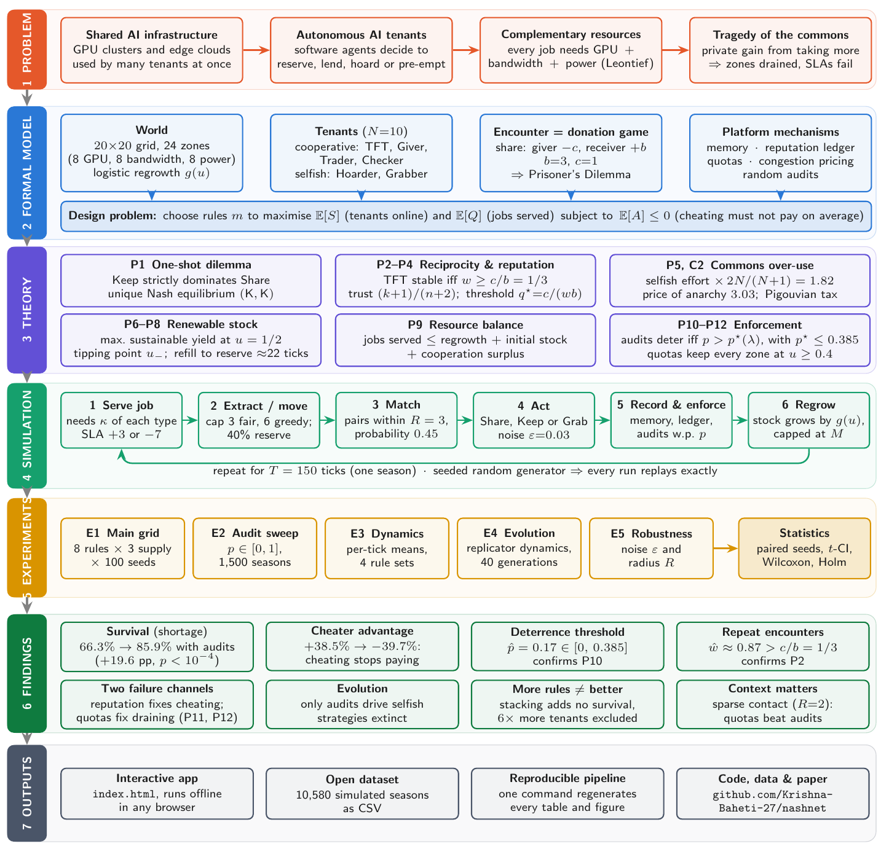

The same pipeline, as it is implemented in this repository:

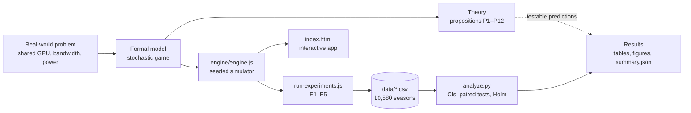

---

## 4. The real-world problem

Modern AI services run on shared infrastructure. A GPU cluster or a metropolitan edge cloud is used by many
tenants at once, and each tenant is increasingly an **autonomous software agent** that decides how much
capacity to reserve, whether to lend idle capacity to a neighbour, and whether to pre-empt someone else.
This is a **common-pool resource** problem:

- **Rivalrous:** a GPU-hour used by one tenant cannot be used by another.
- **Only partly excludable:** tenants can over-reserve, hoard or pre-empt.
- **Renewable:** capacity frees up as jobs finish and energy budgets refill, but more slowly when a site is
  heavily drained.

Every tenant is privately tempted to take more and give less. If every tenant does that, the result is congestion,
SLA violations and tenants dropping offline: the **tragedy of the commons**. The operator cannot control
the agents directly; it can only set the **rules of the game**.

### How the real world maps to the model

| Real-world element | Model element |
|---|---|
| Edge / GPU sites | Capacity zones on a 20 × 20 grid |
| GPU-hours, bandwidth, energy | Three resource types: GPU, bandwidth, power |
| An inference job needs all three | Leontief job: κ = 0.3 units of **every** type |
| Capacity freed as jobs finish, energy refilled | Regrowth law g(u) per zone |
| Lending idle reserved capacity | Donation: giver loses c = 1, receiver gains b = 3 |
| Taking help, never returning it | Defection (Keep) in the donation game |
| Over-reservation, draining a site | Greedy extraction below the 40% safe reserve |
| Pre-empting another tenant | Forced grab |
| SLA uptime; tenant eviction | SLA score in [0, 100]; offline at 0 |
| Revenue from served jobs | Credits |
| Per-tenant resource caps | Quotas |
| Spot / surge pricing | Congestion pricing |
| Usage monitoring, compliance checks | Random audits with fine and restitution |
| Tenant trust scores | Public reputation ledger |

### The operator's design problem

For a rule set $`m`$ and a random season $`\Theta`$ (the seed), let $`S`$ be survival, $`Q`$ the share of jobs
served and $`A`$ the cheater advantage. The operator solves

```math
\max_{m}\ \big(\mathbb{E}[S(m,\Theta)],\ \mathbb{E}[Q(m,\Theta)]\big)
\quad\text{subject to}\quad \mathbb{E}[A(m,\Theta)] \le 0 .
```

In words: keep as many tenants online and as many jobs served as possible, **while making sure that cheating
does not pay on average**. The constraint matters because strategies that earn more get copied (Section 10.4).

---

## 5. The model

### 5.1 World

- **Grid:** 20 × 20 cells. Distance is Chebyshev distance, $`d_\infty(x,y)=\max(|x_1-y_1|,|x_2-y_2|)`$.
- **Zones:** 24 capacity zones, 8 of each type (GPU, bandwidth, power). Each zone has capacity $`M`$ and
  stock $`s\in[0,M]`$; its fill fraction is $`u=s/M`$.
- **Regrowth:** every tick each zone grows by

```math
g(u) = r\,\big(\alpha + \beta\,u(1-u)\big), \qquad \alpha = 0.12,\ \beta = 3.5,
```

  capped at $`M`$. Refill is fastest at half-full and slowest when a zone is nearly empty or nearly full.

- **Supply levels:**

| Supply | Capacity M | Rate r | Max tenants sustainable by regrowth alone |
|---|---|---|---|
| Abundant | 14 | 0.70 | 18.6 |
| Normal | 10 | 0.45 | 11.9 |
| Shortage | 8 | 0.30 | 7.96 (6.8 for power) |

There are 10 tenants, so under shortage **regrowth alone cannot keep everyone online**. Cooperation has to make up the gap.

### 5.2 Tenants

Each tenant holds GPU, bandwidth and power, earns **credits** and has an **SLA score** that starts at 100.

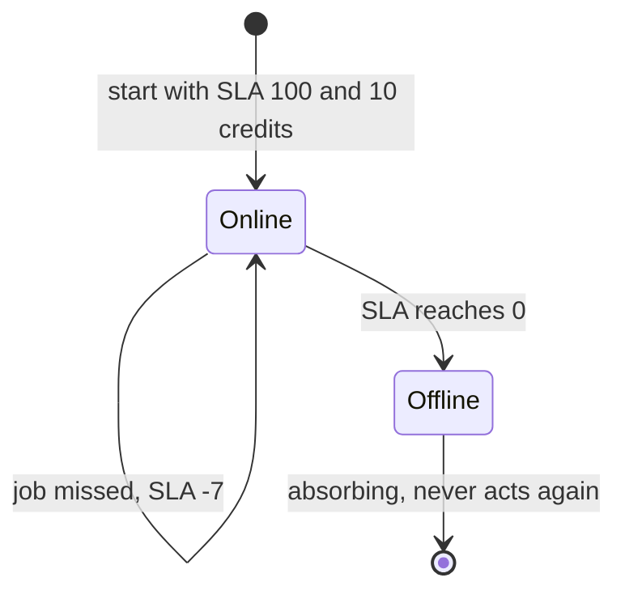

A job is served only if the tenant holds at least κ = 0.3 of **every** resource. With full SLA, a tenant
goes offline on its 15th consecutive miss (⌈100/7⌉ = 15).

### 5.3 Strategies (fixed for a season)

| Strategy | App name | Team | In an encounter | Extraction |
|---|---|---|---|---|
| Tit-for-Tat (TFT) | Mirror | Cooperative | Shares first, then copies the partner's last action | Fair (≤ 3 units, keeps reserve) |
| Always Cooperate (ALLC) | Giver | Cooperative | Always shares | Fair |
| Trader | Trader | Cooperative | Shares if private trust ≥ 0.45 | Fair |
| Reputation-aware (REP) | Checker | Cooperative | Shares if public reputation ≥ 0.5 | Fair |
| Always Defect (ALLD) | Hoarder | Selfish | Always keeps | Greedy (≤ 6 units, ignores reserve) |
| Aggressive (AGGR) | Grabber | Selfish | Tries to grab the partner's capacity | Greedy |

The default population has 10 tenants: 2 TFT, 2 ALLC, 2 Trader, 1 REP (cooperative team of 7) and 2 ALLD, 1 AGGR
(selfish team of 3). When the ledger is on, the ledger-aware strategies (TFT, Trader, Checker) refuse partners
whose reputation is below 0.3.

### 5.4 The encounter: a donation game

When two tenants meet, each chooses **Share (S)** or **Keep (K)**. Sharing costs the giver $`c=1`$ unit of its
most plentiful resource and gives the receiver $`b=3`$ units of its scarcest one. The extra $`b-c=2`$ is the
value of moving idle capacity to where it is actually needed. The payoffs are (row player, column player):

|  | Partner shares | Partner keeps |
|---|---|---|
| **I share** | (b − c, b − c) = **(2, 2)** | (−c, b) = **(−1, 3)** |
| **I keep** | (b, −c) = **(3, −1)** | (0, 0) = **(0, 0)** |

With temptation T = 3, reward R = 2, punishment P = 0 and sucker's payoff S = −1, we have T > R > P > S and 2R > T + S, so this is a **Prisoner's Dilemma**.

---

## 6. One simulation tick

A **season** is 150 ticks. In every tick, each online tenant acts once (lane A, in random order), then the
world updates (lane B):

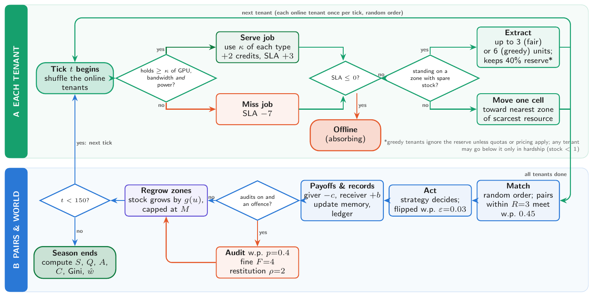

| Step | What happens | Key numbers |
|---|---|---|
| 1. Serve job | Pay idle power, then serve the job if every resource ≥ κ | κ = 0.3, +2 credits, SLA +3 / −7 |
| 2. Extract or move | On a zone with spare stock: extract. Otherwise move one cell toward the nearest zone of the scarcest resource | fair 3, greedy 6, reserve 40%, move cost 0.05 power |
| 3. Match | Online tenants within radius R meet in pairs (at most one partner per tick) | R = 3, meet probability μ = 0.45 |
| 4. Act | Each side plays its strategy; with small probability the action is flipped by mistake | noise ε = 0.03; a grab succeeds w.p. 0.6 |
| 5. Record and enforce | Update private memory and the public ledger; run audits if they are on | p = 0.4, fine F = 4, restitution ρ = 2 |
| 6. Regrow | Every zone grows by g(u), capped at M | α = 0.12, β = 3.5 |

**Determinism.** Every random draw comes from one seeded generator (mulberry32). The same seed and the same
rules therefore always replay the identical season, both in the browser and in Node.js.

---

## 7. The game theory, step by step

Every result below is stated and proved in full in the project report. Here is what each one says and why it
matters for the simulation.

### P1. A single encounter is a Prisoner's Dilemma

Keep earns exactly $`c`$ more than Share **whatever the partner does**:

```math
v(K,a_2) - v(S,a_2) = c > 0 .
```

So Keep **strictly dominates** Share, and (Keep, Keep) is the **unique Nash equilibrium**. Yet (Share, Share)
gives both players 2 instead of 0, so selfishness destroys the entire surplus of the encounter.
*Consequence:* without some rule, rational tenants never share.

### P2. Repeated encounters: reciprocity works if and only if $`w \ge c/b`$

Suppose a pair meets again with probability $`w`$. Two TFT players share forever and earn
$`\frac{b-c}{1-w}`$. An Always-Defect player earns $`b`$ once against TFT and then nothing more. So TFT is at least as good iff

```math
\frac{b-c}{1-w} \;\ge\; b \quad\Longleftrightarrow\quad w \;\ge\; \frac{c}{b} = \frac{1}{3}.
```

The same threshold holds against a one-shot deviator. *Consequence:* memory helps only if tenants meet the same partners often enough.
We **measure** $`\hat w`$ in every season (Section 11).

### P3. Reputation is Bayesian inference

Start from a uniform prior on a partner's sharing probability $`q`$. After $`k`$ shares in $`n`$ actions, the
posterior is $`\mathrm{Beta}(k+1,\,n-k+1)`$, whose mean is the Laplace estimator

```math
\hat q = \frac{k+1}{n+2}.
```

A stranger gets $`\hat q = 1/2`$. NashNet uses this formula for both private trust and public reputation.

### P4. When should you trust someone?

If sharing costs $`c`$ now and pays $`b`$ later only when you meet again (probability $`w`$) **and** the partner reciprocates
(probability $`q`$), sharing is worth it iff

```math
q \;\ge\; q^\star = \frac{c}{w\,b} \approx 0.38 \quad (\text{at } \hat w \approx 0.87).
```

The Trader's threshold (0.45) and the Checker's (0.5) are therefore slightly conservative.

### P5. Over-extraction and the price of anarchy (Gordon–Schaefer commons)

Each of $`N`$ tenants chooses an extraction effort $`e_i`$. The return per unit of effort falls with total effort
$`E`$, so tenant $`i`$ earns $`v_i = e_i(a_0 - a_1E) - \zeta e_i`$. Comparing the social optimum with the Nash equilibrium:

```math
E^\star = \frac{a_0-\zeta}{2a_1}, \qquad
E^{\mathrm{NE}} = \frac{N}{N+1}\cdot\frac{a_0-\zeta}{a_1}, \qquad
\frac{E^{\mathrm{NE}}}{E^\star} = \frac{2N}{N+1}, \qquad
\mathrm{PoA} = \frac{(N+1)^2}{4N}.
```

For $`N=10`$, selfish tenants extract **1.82×** the optimal amount and welfare falls by a factor of **3.03**.
NashNet's greedy cap (6) is twice the fair cap (3), close to 1.82.

**Corollary (Pigouvian tax).** A per-unit tax $`t^\star = \frac{(N-1)(a_0-\zeta)}{2N}`$ makes the optimum the
equilibrium. Congestion pricing in NashNet is a two-level version of this tax.

### P6–P8. Renewable capacity: sustainable yield, tipping, recovery

- **MSY (P6).** $`g`$ peaks at $`u = 1/2`$. A zone kept at 40% still regrows at 96.5% of the peak rate, whereas
  an empty zone regrows at only 12% of it. This is why the safe reserve is 40%.
- **Tipping (P7).** With constant extraction $`h`$, the stock has two equilibria
  $`u_\pm = \tfrac12 \pm \sqrt{\tfrac14 - (h/r-\alpha)/\beta}`$. Here $`u_+`$ is stable and $`u_-`$ is a
  **tipping point**: once a zone falls below $`u_-`$ it collapses to empty, even if extraction later drops back to a sustainable level.
- **Recovery (P8).** An empty zone needs $`T_{\mathrm{rec}} = \int_0^{0.4}\frac{M\,du}{g(u)}`$ ticks to refill
  to its reserve: about 22 ticks under shortage, roughly 15% of a season.

### P9. Resource balance: why who holds capacity matters more than how much exists

For each resource type, the jobs served per tick are bounded by

```math
\frac{1}{T}\sum_t J(t) \;\le\; \frac{1}{\kappa}\Big(\underbrace{\tfrac{\Phi_k(0)}{T}}_{\text{initial stock}}
+ \underbrace{Z\,g_{\max}}_{\text{regrowth}} + \underbrace{\bar D_k}_{\text{net gain from sharing}}\Big).
```

Every donation **creates** $`b-c=2`$ units of net capacity. In the data, aggregate supply is never the
binding constraint. Tenants fail because capacity sits with the wrong holders, which is why mechanisms that
redistribute capacity help.

### P10. Audits: a Becker deterrence threshold

Let $`\lambda`$ be the credit value of one resource unit. Each offence is caught with probability $`p`$; the offender
then pays a fine $`F`$ and gives $`\rho`$ units back to its victim. Keep's advantage over Share becomes
$`\delta = \lambda c - p(F + \lambda\rho)`$ whatever the partner does, so **Share becomes dominant** iff

```math
p \;>\; p^\star(\lambda) = \frac{c\,\lambda}{F + \rho\,\lambda}.
```

Since a unit can never be worth more than $`\lambda_{\max} = 2/\kappa = 20/3`$ credits,
$`p^\star \le 5/13 \approx 0.385`$ for **every** admissible valuation. The default $`p = 0.4`$ is just above this bound.

### P11. Audits only partly deter draining

Draining $`\Delta x`$ units is deterred iff $`\lambda\Delta x < \frac{p}{1-p}F`$, which at the defaults means only gains
worth less than 2.67 credits. *Prediction:* audits improve zone reserves much less than quotas do.

### P12. Quotas keep every zone safe

Under quotas, no take may leave a zone below 40% (except in hardship), so $`u \ge 0.4`$ stays true forever and no zone can
cross the tipping point.

---

## 8. Mechanisms: what each rule fixes

| Switch | What it does | Real-world analogue | Theory |
|---|---|---|---|
| **Memory** | Each tenant remembers how each partner treated it | Bilateral history | P2, P4 |
| **Reputation ledger** | Public record of every action, with a "standing" rule: refusing a bad-reputation partner is not counted against you | Platform trust score | P3 |
| **Quotas** | Everyone takes at most 3 units and must leave 40% in the zone (unless in hardship) | Per-tenant resource caps | P12 |
| **Congestion pricing** | 0.3 credits per unit, or 1.5 if the zone ends below 40% | Surge or spot pricing | P5 (Pigouvian tax) |
| **Random audits** | Every offence is caught with probability 0.4: fine 4 credits plus restitution 2 units | Usage monitoring, compliance | P10, P11 |

The eight rule sets compared in the experiments are No rules, Memory only, Memory + reputation, Commons quotas,
Congestion pricing, Random audits, Reputation + audits, and All mechanisms. Quotas, pricing and audits are
tested **with memory off** so that their own effect is isolated.

The key structural insight is that the commons fails through **two separate channels**, and each mechanism
acts on one or both of them:

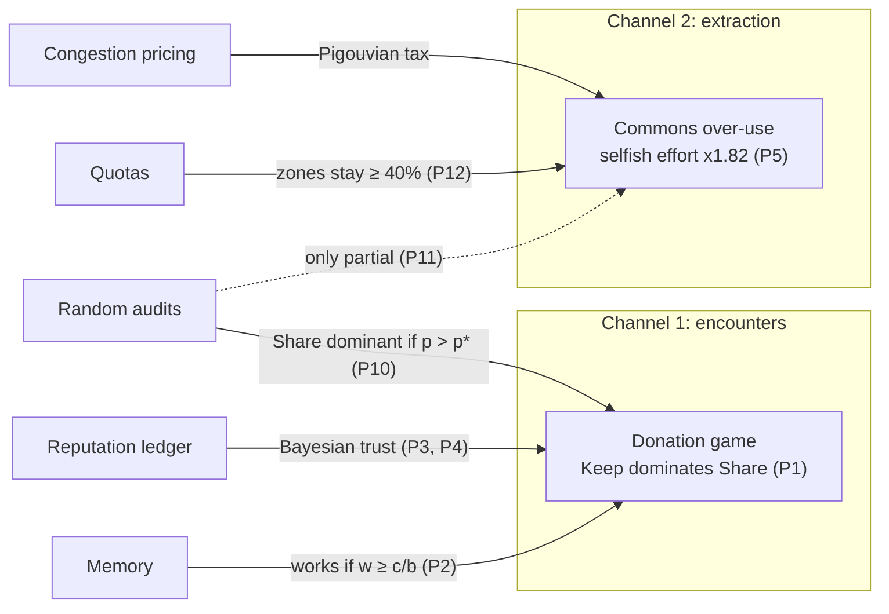

---

## 9. Experiments and statistical method

| ID | Question | Design | Seasons |
|---|---|---|---|
| **E1** | Which rule set works best? | 8 rule sets × 3 supply levels × 100 seeds | 2,400 |
| **E2** | How strong must audits be? | Audits only, shortage, p ∈ {0, 0.05, …, 0.4} ∪ {0.5, 0.6, …, 1} (15 values) × 100 seeds | 1,500 |
| **E3** | How does a season unfold? | Per-tick means, 4 rule sets × 100 seeds | 400 |
| **E4** | Which behaviour survives evolution? | Replicator dynamics, 4 rule sets, 40 generations, 20 seasons per generation | 3,280 |
| **E5** | Are the results robust? | Noise ε ∈ {0, 0.03, 0.1} and radius R ∈ {2, 3, 4}, 5 rule sets × 100 seeds | 3,000 |

**How the statistics are done**

- **Common random numbers.** Every rule set is run on the *same* seeds 1–100, so each comparison is
  paired: $`D_\theta = Y(m,\theta) - Y(\text{no rules},\theta)`$. Pairing removes the seed-to-seed noise that
  both rule sets share.
- **Intervals.** 95% $`t`$-confidence intervals, $`\bar Y \pm t_{n-1,\,0.975}\, s/\sqrt n`$.
- **Tests.** Paired $`t`$-test with effect size $`d_z = \bar D / s_D`$, plus the Wilcoxon signed-rank test as a check
  that does not assume normality.
- **Multiple comparisons.** Seven mechanisms are compared with the baseline, so the p-values are adjusted with Holm's step-down
  procedure (family-wise error rate 0.05).
- **Replicator dynamics.** $`x_s(g+1) = x_s(g) f_s(g) / \sum_{s'} x_{s'}(g) f_{s'}(g)`$, where the fitness $`f_s`$ is a strategy's mean
  final credits over 20 seasons. The shares are rounded to 10 seats with the largest-remainder method.
- **Measuring w.** If each pair's encounters are geometric, the maximum-likelihood estimate is
  $`\hat w = 1 - \#\text{pairs} / \#\text{encounters}`$.

**Metrics:** survival $`S`$ (share of tenants online at tick 150), service $`Q`$ (jobs served ÷ jobs demanded),
cheater advantage $`A = \bar\omega_{\text{selfish}}/\bar\omega_{\text{coop}} - 1`$ (credits), cooperation rate $`C`$,
Gini coefficient of final credits, and final zone reserve.

---

## 10. Results in detail

### 10.1 Main grid (E1)

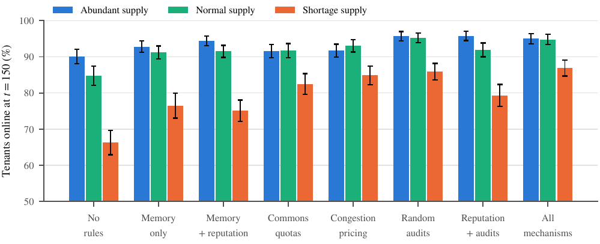

Survival (%) at each supply level:

| Rule set | Abundant | Normal | Shortage |
|---|---|---|---|
| No rules | 90.1 | 84.8 | 66.3 |
| Memory only | 92.8 | 91.2 | 76.5 |
| Memory + reputation | 94.4 | 91.5 | 75.1 |
| Commons quotas | 91.6 | 91.7 | 82.5 |
| Congestion pricing | 91.7 | 93.0 | 84.9 |
| Random audits | 95.7 | 95.2 | 85.9 |
| Reputation + audits | 95.8 | 91.9 | 79.3 |
| All mechanisms | 95.0 | 94.8 | 86.9 |

The scarcer the supply, the bigger the differences between rule sets. Under abundant supply all of them work.

### 10.2 Paired comparison with No rules (shortage)

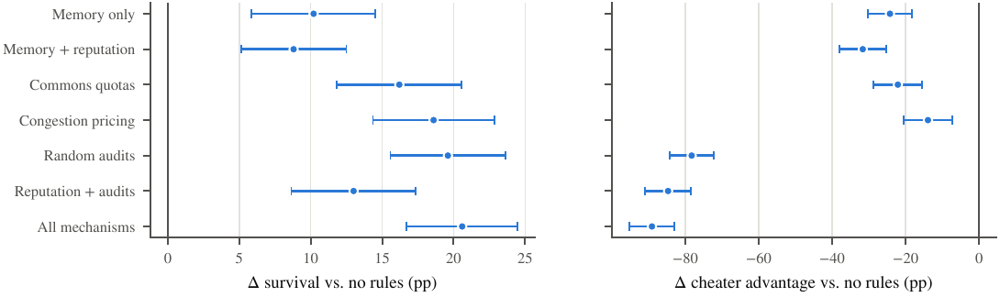

| Rule set | Δ survival (pp) | Cohen's d_z | Δ cheater advantage (pp) |
|---|---|---|---|
| Memory only | +10.2 ± 4.3 | 0.47 | −24.3 |
| Memory + reputation | +8.8 ± 3.7 | 0.47 | −31.7 |
| Commons quotas | +16.2 ± 4.4 | 0.74 | −22.1 |
| Congestion pricing | +18.6 ± 4.2 | 0.87 | −13.9 |
| **Random audits** | **+19.6 ± 4.0** | **0.97** | **−78.3** |
| Reputation + audits | +13.0 ± 4.4 | 0.59 | −84.7 |
| All mechanisms | +20.6 ± 3.9 | 1.05 | −89.1 |

All effects are significant after Holm correction (p < 10⁻⁴).

### 10.3 Within a season (E3)

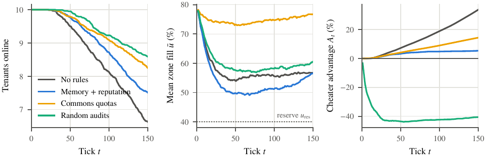

Without rules, tenants drop out steadily as the cooperators are exploited. Quotas keep the zones fullest (the middle panel).
Audits flip the cheater advantage negative early in the season and keep it there.

### 10.4 Evolution (E4)

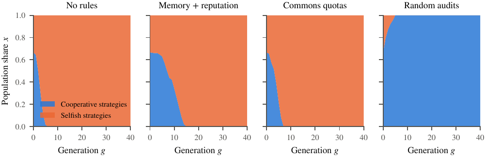

| Rule set | Selfish strategies become the majority at generation | Final state |
|---|---|---|
| No rules | 2 | Grabber takes over |
| Memory + reputation | 8 | Grabber takes over |
| Commons quotas | 4 | Grabber takes over |
| **Random audits** | never | **Selfish strategies extinct**; the four cooperative strategies coexist at shares of 0.24–0.26 |

### 10.5 Robustness (E5)

Survival % under shortage (cheater advantage % in brackets):

| Setting | No rules | Memory | Mem. + rep. | Quotas | Audits |
|---|---|---|---|---|---|
| ε = 0 | 67.8 (+39) | 76.6 (+16) | 75.0 (+5) | 83.8 (+17) | 87.6 (−44) |
| ε = 0.03 (default) | 66.3 (+39) | 76.5 (+14) | 75.1 (+7) | 82.5 (+16) | 85.9 (−40) |
| ε = 0.1 | 69.9 (+34) | 71.3 (+21) | 75.2 (+17) | 86.9 (+15) | 88.8 (−39) |
| R = 2 | 51.1 (+63) | 55.9 (+34) | 51.9 (+28) | **79.5** (+18) | 69.6 (−26) |
| R = 4 | 77.3 (+26) | 82.6 (+11) | 82.0 (+5) | 83.9 (+17) | 92.2 (−50) |

The ranking holds except under **sparse contact (R = 2)**. Audits act through encounters, so when tenants rarely meet,
quotas (which act on extraction) win. The best mechanism depends on how the tenants interact.

---

## 11. Theory versus measurement

| Prediction | Theory | Measured | Verdict |
|---|---|---|---|
| Reciprocity needs $`w \ge c/b`$ (P2) | 1/3 | $`\hat w`$ = 0.870–0.921 in all 24 conditions | ✔ satisfied by a wide margin; memory alone cuts the cheater advantage by 24.3 pp |
| Audit deterrence threshold (P10) | $`p^\star \in [0, 0.385]`$ | Cheater advantage crosses zero at $`\hat p`$ = 0.171 | ✔ inside the band (implied $`\hat\lambda \approx 1.04`$) |
| Audits only partly protect zones (P11) | Small effect on reserves | Reserve 60.6% (audits) vs 56.7% (none) vs 76.7% (quotas) | ✔ |
| Quotas keep zones ≥ 40% (P12) | Always | Minimum mean reserve 72.9% under quotas | ✔ |
| Shortage cannot sustain 10 tenants from regrowth alone (P9) | ≤ 6.8 by power regrowth | 8.02 jobs/tick, made possible by initial stock and the sharing surplus | ✔ consistent with the full bound |
| Conditional-cooperation threshold (P4) | $`q^\star \approx 0.38`$ | Trader / Checker use 0.45 / 0.5 | ✔ slightly conservative |

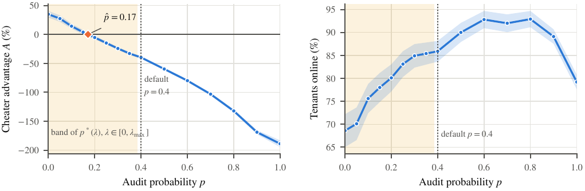

Survival is **not** monotone in the audit probability. It peaks at about 93% for p between 0.6 and 0.8 and falls to 79% at p = 1,
because very frequent audits also punish cooperators' accidental (noise) defections and push the selfish tenants out entirely.

---

## 12. The interactive application

`index.html` is a single self-contained file. It runs offline, needs no server, and uses the same engine as the
experiments, so anything shown in the app can be reproduced exactly from its seed.

| Screen | URL | What it shows |
|---|---|---|
| **Welcome** | `index.html#/welcome` | A six-round Share/Keep mini-game against a bot: you feel Proposition 1 before you read it |
| **World** | `index.html#/world` | The live map, step-by-step controls, an inspector for any tenant, a narrator, outcome charts, and a **live leaderboard** of credits, SLA and rank |
| **Policy Showdown** | `index.html#/showdown` | The **same seed** run under four rule sets side by side |
| **Experiment Lab** | `index.html#/lab` | Real batch runs in the browser, with dot plots, confidence intervals and a supply heatmap |

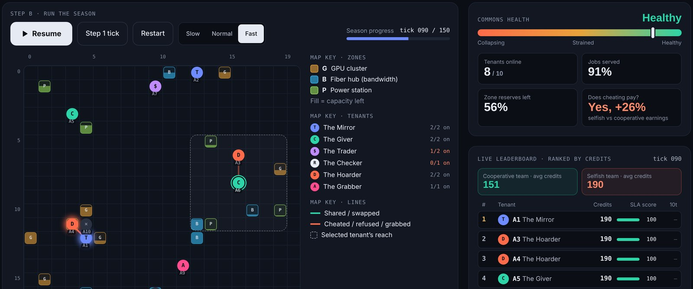

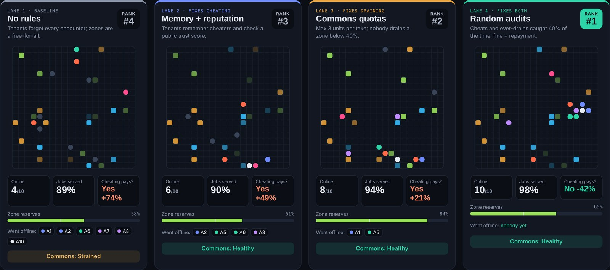

### A five-minute demo script

1. **Welcome (1 min).** Play the six rounds. Point out that Keep always earns more in a single round, so the
   one-shot game is a Prisoner's Dilemma (P1).
2. **World (2 min).** Use seed 166, shortage, no rules. Press play and watch the selfish tenants climb the
   leaderboard while cooperators' SLA bars fall. Pause, click a tenant, and step through one tick to show the
   loop of Section 6.
3. **Policy Showdown (1 min).** Same seed, four rule sets. With no rules only 4 of 10 tenants stay online and cheaters earn 74% more.
   With random audits all 10 stay online and cheaters earn 42% less.
4. **Experiment Lab (1 min).** Run a batch to show that the effect is statistical and not luck: dot plots with
   confidence intervals, and the supply heatmap.

---

## 13. Implementation environment and setup

### 13.1 Requirements

| Component | Needed for | Version tested | Required? |
|---|---|---|---|
| Web browser (Chrome, Edge, Firefox, Safari) | Running the app | Current versions | **Yes**, for the app only |
| Node.js | Engine checks, experiments, rebuilding the app | 22.x (any ≥ 18 works) | For reproducing the results |
| Python + NumPy, pandas, SciPy, Matplotlib | Statistics, figures, tables | Python 3.13, NumPy 2.5, pandas 3.0, SciPy 1.18, Matplotlib 3.11 (any Python ≥ 3.10) | For regenerating figures |

**npm packages are not needed.** The engine and all scripts use only the Node.js standard library.

### 13.2 Run the app (no installation)

1. Download the repository (green **Code** button → **Download ZIP**) or clone it:
   ```bash
   git clone https://github.com/Krishna-Baheti-27/nashnet.git
   cd nashnet
   ```
2. Double-click `index.html`. That is all.

Without internet the custom fonts fall back to system fonts; everything else works.
The app can also be published with **GitHub Pages** (Settings → Pages → Deploy from a branch → `main`, folder `/ (root)`).

### 13.3 Reproduce every result

Run from the repository root:

```bash
# 1. sanity checks: determinism and invariants (a few seconds)
node scripts/check.js

# 2. all five experiments, writes data/*.csv (about 30-40 s)
node scripts/run-experiments.js --seeds 100

# 3. statistics, figures, tables and data/summary.json (about 6 s)
python3 -m pip install -r requirements.txt
python3 scripts/analysis/analyze.py
```

Step 3 writes the figures and tables to a local `results/` folder (generated output, not tracked by Git)
and rewrites `data/summary.json`.

On Windows, use `py` instead of `python3` (for example `py -m pip install -r requirements.txt`).

The same steps are available as npm scripts: `npm test` (same as `npm run check`), `npm run experiments`,
`npm run analyze`, `npm run build`.

**Expected output of step 1:**

```
determinism
  ok   same seed gives the same season: none
  ...
  ok   same seed gives the same season: all
invariants (20 seeds x 8 rule sets x 3 supply levels)
  ok   zone stock never negative
  ok   zone stock never above capacity
  ok   tenant holdings never negative
  ok   SLA stays in [0, 100]
  ok   offline tenants never act again
  ok   quotas never drive a zone below zero
all checks passed
```

**Expected output of step 2:**

```
wrote data/e1_main.csv (2400 rows)
wrote data/e2_audit_sweep.csv (1500 rows)
wrote data/e3_timeseries.csv (600 rows)
wrote data/e4_replicator.csv (984 rows)
wrote data/e5_robustness.csv (3000 rows)
```

Because the engine is deterministic, the CSV files regenerated in step 2 are **byte-for-byte identical** to the
committed ones (`git status` lists no changed CSV files), and step 3 reproduces `data/summary.json` exactly.

### 13.4 Rebuild the app after editing a screen

```bash
node scripts/build.js      # bundles engine + runtime + screens into index.html
```

---

## 14. Verifying the project in ten minutes

A checklist for a reviewer who wants to confirm that the claims are real:

| # | Check | Command or action | What you should see |
|---|---|---|---|
| 1 | The app runs offline | Open `index.html` with Wi-Fi off | All four screens work |
| 2 | Same seed gives the same season | Open the Showdown twice with seed 166 | Identical outcomes |
| 3 | The engine is correct and deterministic | `node scripts/check.js` | `all checks passed` |
| 4 | The data are genuine | `node scripts/run-experiments.js` then `git status` | CSV files unchanged |
| 5 | The reported numbers come from the data | `python3 scripts/analysis/analyze.py`, then open `data/summary.json` | e.g. `"e2_p_cross": 0.171…`, `"poa": 3.025` |
| 6 | The theory matches | Compare Section 11 with `summary.json` | Same values |

---

## 15. Using the engine from code

```js
const makeEngine = require('./engine/engine.js');
const E = makeEngine();

// one full season with a predefined rule set
const r = E.run({ seed: 166, scarcity: 'shortage', regs: E.RULESETS.audit.regs });
console.log(r.survival, r.cheatAdv, r.wHat);   // 1  -0.4216  0.887

// tick by tick
const S = E.create({ seed: 7, scarcity: 'normal', regs: { memory: true, ledger: true } });
for (let t = 0; t < 150; t++) E.step(S);
console.log(E.summary(S));
```

| Option | Values | Default |
|---|---|---|
| `seed` | any positive integer | 42 |
| `scarcity` | `'abundant'`, `'normal'`, `'shortage'` | `'shortage'` |
| `regs` | `{ memory, ledger, quotas, pricing, audits }` (booleans) | `{ memory: true }`, everything else off |
| `params` | override any entry of `E.DEFAULTS`, e.g. `{ auditProb: 0.2, radius: 2 }` | see `engine/engine.js` |

> **Note.** Switches you leave out of `regs` take their defaults, and **memory is on by default**. To reproduce a
> rule set from the experiments exactly, pass its predefined switches: `E.RULESETS.<key>.regs` with key `none`,
> `memory`, `rep`, `quota`, `pricing`, `audit`, `repaudit` or `all`.

`run()` returns `online`, `survival`, `served`, `cheatAdv`, `coop`, `gini`, `reserve`, `encounters`,
`pairsMet`, `wHat`, `audits`, `gifts`, `byStrategy`, `selfishOffline` and `coopOffline`.

---

## 16. Dataset

All data are produced by the simulation; **no external dataset is used**. Each CSV row is one simulated
season (or one tick, or one generation, where stated). The complete column dictionary is in
[`data/README.md`](data/README.md).

| File | Experiment | Rows |
|---|---|---|
| `data/e1_main.csv` | 8 rule sets × 3 supply levels × 100 seeds | 2,400 |
| `data/e2_audit_sweep.csv` | Audit probability 0 to 1, shortage | 1,500 |
| `data/e3_timeseries.csv` | Per-tick means, 4 rule sets | 600 |
| `data/e4_replicator.csv` | Replicator dynamics, 40 generations | 984 |
| `data/e5_robustness.csv` | Noise and interaction-radius sensitivity | 3,000 |
| `data/summary.json` | Every number reported in this README | – |

**Public resources that motivate the setting** (useful for future calibration; not used here):

- Acme trace of LLM development in a datacenter (NSDI 2024): https://github.com/InternLM/AcmeTrace
- Google cluster traces (Borg): https://github.com/google/cluster-data
- Alibaba GPU cluster traces: https://github.com/alibaba/clusterdata

---

## 17. Repository layout and architecture

```
nashnet/
├── index.html                    the complete interactive app (open this)
├── engine/
│   └── engine.js                 simulation engine: no dependencies, deterministic per seed
├── src/
│   ├── runtime.js                small template renderer used by the app screens
│   └── screens/                  welcome.html, world.html, showdown.html, lab.html
├── scripts/
│   ├── build.js                  bundles engine + runtime + screens into index.html
│   ├── check.js                  determinism and invariant checks
│   ├── run-experiments.js        runs E1–E5, writes data/*.csv
│   └── analysis/analyze.py       statistics, figures, tables, summary.json
├── data/                         generated dataset + data dictionary
├── docs/img/                     images used in this README
├── package.json                  npm scripts (no dependencies)
├── requirements.txt              Python packages for the analysis
└── LICENSE
```

**How the files depend on each other.** One engine feeds both the app and the experiments, so the
browser and the reported results can never disagree.

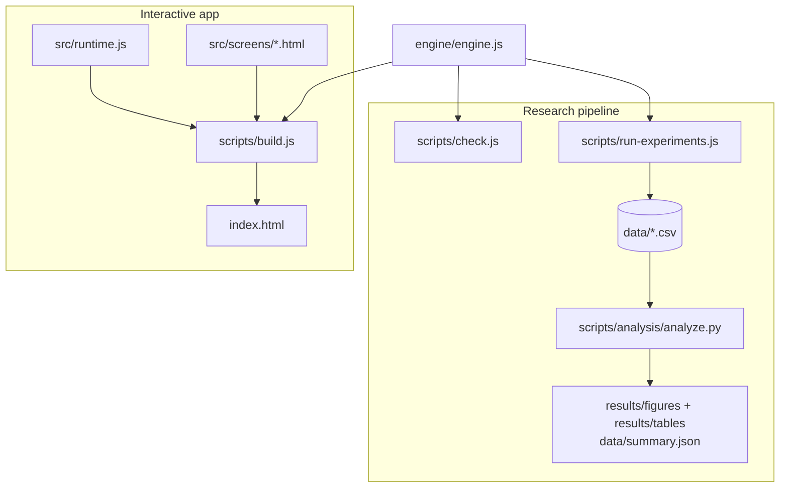

---

## 18. Troubleshooting

| Problem | Fix |
|---|---|
| `index.html` opens as text or downloads instead | Right-click → **Open with** → your browser |
| The fonts look plain | You are offline; the app falls back to system fonts. Nothing else is affected |
| `node: command not found` / `'node' is not recognized` | Install Node.js LTS from https://nodejs.org and open a **new** terminal |
| `python3: command not found` (Windows) | Use `py` or `python` instead of `python3` |
| `ModuleNotFoundError: No module named 'pandas'` | `python3 -m pip install -r requirements.txt` (add `--user` if you lack permissions) |
| `error: externally-managed-environment` (recent Linux/macOS) | Create a virtual environment first: `python3 -m venv .venv && source .venv/bin/activate`, then install |
| `run-experiments.js` seems slow | It runs about 10,000 seasons; 30–60 s is normal. Use `--seeds 20` for a quick run |
| Mermaid diagrams do not render | View this README on GitHub, or use an editor with Mermaid support |

---

## 19. Frequently asked questions

**Why a simulation and not real cluster traces?** Mechanisms are counterfactual: we need to run the *same*
world under eight different rule sets, which a historical trace cannot do. The theory gives the direction and
the thresholds of each effect, and the simulation measures their size.

**Why are the strategies fixed?** Fixed strategies make every effect attributable to the rule set. Adaptation enters
through the replicator dynamics of E4, where strategies that earn more spread.

**Why is "No rules" run without memory?** It is the pure one-shot baseline of Proposition 1. "Memory only"
then isolates what direct reciprocity adds.

**Why audit probability 0.4?** It is just above the calibration-free bound $`p^\star \le 5/13 \approx 0.385`$, so sharing is
dominant for every valuation a tenant could have, while still lying on the rising part of the survival curve.

**Why do audits help survival if they barely protect the zones?** Because the binding constraint is *who holds* capacity
(P9). Restitution moves resources back to the victims, and deterrence keeps the sharing surplus alive.

**Is the randomness fair across rule sets?** Yes. Every rule set uses the same 100 seeds (common random numbers), and
all comparisons are paired.

---

## 20. Limitations

- **Fixed rules, not learning agents.** Reinforcement-learning or LLM-driven tenants are a natural extension.
- **Hand-calibrated parameters.** They were chosen so that effects show within a 150-tick season. E5 checks noise and radius only.
- **A single marginal value λ.** Real valuations depend on the state, which is why we report a band rather than a point prediction.
- **Small population (N = 10).** We report means over 100 seasons and draw conclusions only from paired tests.
- **Synthetic data.** Public GPU-cluster traces motivate the setting but were not used for calibration.

---

## 21. References

Recent work (2024–2025):

- G. Piatti *et al.*, "Cooperate or Collapse: Emergence of Sustainable Cooperation in a Society of LLM Agents," *NeurIPS*, 2024.
- E. Akata *et al.*, "Playing Repeated Games with Large Language Models," *Nature Human Behaviour*, 9(7), 2025.
- A. F. Ashery, L. M. Aiello, A. Baronchelli, "Emergent Social Conventions and Collective Bias in LLM Populations," *Science Advances*, 11(20), 2025.
- Y. Murase, C. Hilbe, "Computational Evolution of Social Norms in Well-Mixed and Group-Structured Populations," *PNAS*, 121(33), 2024.
- P. Duetting *et al.*, "Mechanism Design for Large Language Models," *Proc. ACM Web Conference (WWW)*, 2024.
- Q. Hu *et al.*, "Characterization of Large Language Model Development in the Datacenter," *USENIX NSDI*, 2024.
- Y. Sheng *et al.*, "Fairness in Serving Large Language Models," *USENIX OSDI*, 2024.
- J. Duan *et al.*, "MuxServe: Flexible Spatial-Temporal Multiplexing for Multiple LLM Serving," *ICML*, 2024.
- T. Guo *et al.*, "Large Language Model Based Multi-Agents: A Survey of Progress and Challenges," *IJCAI*, 2024.
- L. Wang *et al.*, "A Survey on Large Language Model Based Autonomous Agents," *Frontiers of Computer Science*, 18(6), 2024.

Foundational results the proofs build on:

- J. F. Nash, "Equilibrium Points in n-Person Games," *PNAS*, 36(1), 48–49, 1950.
- H. S. Gordon, "The Economic Theory of a Common-Property Resource: The Fishery," *Journal of Political Economy*, 62(2), 124–142, 1954.
- G. Hardin, "The Tragedy of the Commons," *Science*, 162(3859), 1243–1248, 1968.
- G. S. Becker, "Crime and Punishment: An Economic Approach," *Journal of Political Economy*, 76(2), 169–217, 1968.
- P. D. Taylor, L. B. Jonker, "Evolutionary Stable Strategies and Game Dynamics," *Mathematical Biosciences*, 40(1–2), 145–156, 1978.
- S. Holm, "A Simple Sequentially Rejective Multiple Test Procedure," *Scandinavian Journal of Statistics*, 6(2), 65–70, 1979.
- E. Ostrom, *Governing the Commons: The Evolution of Institutions for Collective Action*, Cambridge University Press, 1990.
- M. A. Nowak, "Five Rules for the Evolution of Cooperation," *Science*, 314(5805), 1560–1563, 2006.
- A. Ghodsi *et al.*, "Dominant Resource Fairness: Fair Allocation of Multiple Resource Types," *USENIX NSDI*, 2011.

---

## 22. How to cite

```bibtex
@misc{baheti2026nashnet,
  author       = {Krishna Baheti and Divam Shah},
  title        = {{NashNet}: A Game-Theoretic Agent-Based Testbed for Mechanism Design
                  in Shared {AI} Compute Commons},
  year         = {2026},
  howpublished = {Course project, AI301 Game Theory, SVNIT Surat},
  url          = {https://github.com/Krishna-Baheti-27/nashnet}
}
```

---

## 23. License

MIT, see [`LICENSE`](LICENSE).

## Acknowledgment

This work was carried out as the course project for AI301 Game Theory at the Department of Artificial
Intelligence, SVNIT Surat. We thank Dr. Nitesh A. Funde for his guidance and review.
